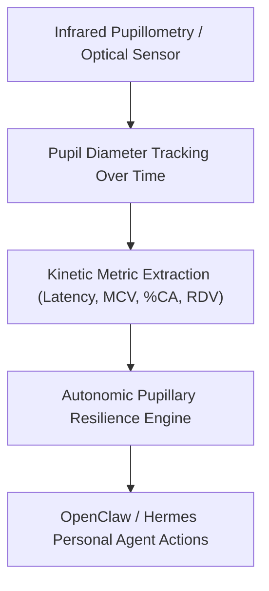

# Quantitative Pupillary Light Reflex (PLR) Skill

[](LICENSE)
[](https://www.python.org/)
[](requirements.txt)
[](mcp_server.py)
[](SKILL.md)

Zero-dependency sovereign personal agent skill for non-invasive calculation of Pupillary Light Reflex (PLR) dynamics, autonomic tone, and central nervous system alertness.



## Features
- **Deterministic Math**: Pure Python standard library implementation with zero external dependencies.
- **Pupillometric Standard Metrics**: Implements validated equations for constriction velocity, amplitude percentage, and redilation rate.
- **Autonomic Tone Assessment**: Quantifies balance between cholinergic parasympathetic and adrenergic sympathetic branches.
- **Model Context Protocol (MCP)**: Native JSON-RPC tool integration for LLMs and autonomous agents.

## Quickstart

```python
from client import PupilLightReflexClient

client = PupilLightReflexClient()
result = client.evaluate_pupillary_dynamics(
    baseline_diameter_mm=4.3,
    minimum_diameter_mm=2.6,
    constriction_latency_ms=225.0,
    constriction_velocity_mm_s=4.9,
    redilation_velocity_mm_s=1.85
)
print("Constriction Amplitude:", result["constriction_amplitude_mm"], "mm")
print("Classification:", result["classification"])
```

## License
Apache-2.0
